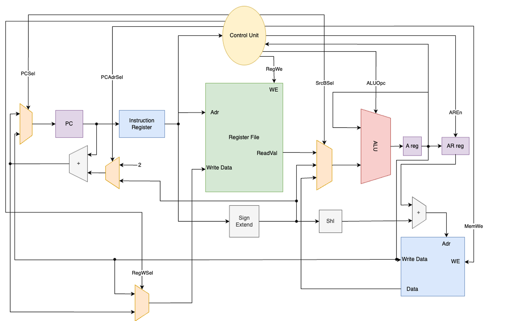
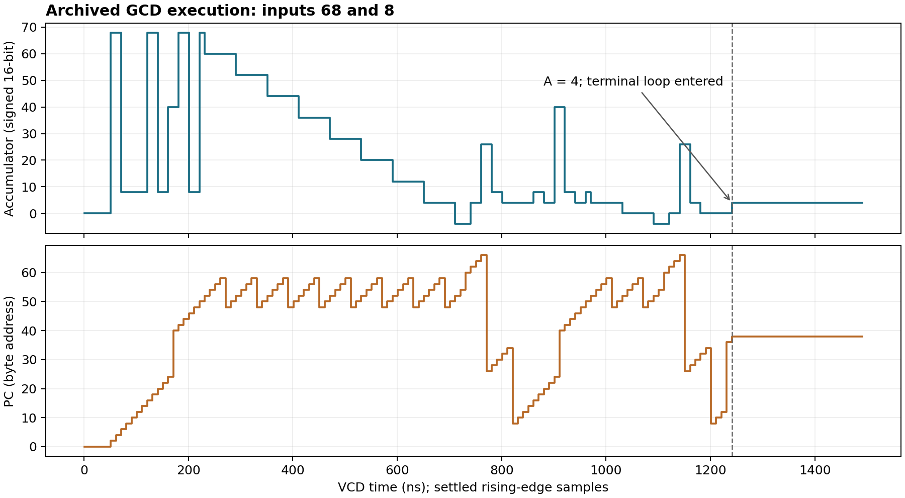

# Leros-Style 16-Bit Processor in Chisel

A Scala/Chisel implementation of a 16-bit accumulator processor with masked instruction decoding, register and indirect memory operations, conditional branches, and jump-and-link control flow. The supplied program computes **GCD(68, 8) = 4** using a subtraction-based remainder routine.

The archived simulation waveform reaches accumulator value **4** and byte-addressed **PC = 38** on the **120th active clock edge**, then remains in the terminal branch loop. This result was extracted from the supplied VCD; no new Chisel simulation was run during repository preparation.

## Engineering problem

The design connects an accumulator datapath to a compact instruction decoder and implements byte-addressed control flow over 16-bit memory words. The extended program uses `BrLT` to terminate repeated subtraction, calls a remainder routine with `JAL`, and returns through a saved register value.

The repository preserves one integrated source version. The base processor and GCD extension are described separately below; they are not independent historical releases.

## Architecture



_Accumulator datapath and control signals extracted from the supplied design specification. The block labeled “Instruction Register” in the drawing is implemented by `InstructionMemory` in the source._

| Component                  | Implementation                                                                 |
| -------------------------- | ------------------------------------------------------------------------------ |
| Instruction and data width | 16 bits                                                                        |
| Instruction format         | 8-bit opcode, 8-bit register index or signed immediate                         |
| Accumulator                | 16-bit A register, updated from the ALU each cycle                             |
| Register file              | 256 × 16 bits, reset to zero, one addressed read/write location                |
| PC and address register    | 16-bit PC; enabled 16-bit AR                                                   |
| Memories                   | Separate `Mem(65536, ...)` instruction and data arrays with asynchronous reads |
| Control                    | Combinational decoder with opcode masks and accumulator zero/sign predicates   |
| Top level                  | `Leros`, containing `DataPath` and `Controller`; no external data interface    |

The PC normally advances by two bytes. Instruction memory is indexed with `PC(15,1)`. Indirect data access forms `AR + (signExtendedImm << 1)` and selects bits 15:1 as the word index. Although each memory declares 65,536 words, these integrated address paths reach only 32,768 word locations. Odd addresses lose their low bit; no alignment exception is implemented.

## Base processor

The datapath supports register/immediate arithmetic and logic, accumulator loads, register stores, address-register updates, indirect memory operations, branches, and jump-and-link.

| Group              | Decoded instructions                |
| ------------------ | ----------------------------------- |
| Arithmetic         | ADD, ADDI, SUB, SUBI, SHR           |
| Logical operations | AND, ANDI, OR, ORI, XOR, XORI       |
| Data movement      | Ld, LdI, Str, LdAddr, LdInd, StrInd |
| Control flow       | JAL, Br, BrZ                        |
| Extension          | BrLT                                |

Immediate values are sign-extended from 8 to 16 bits. `SHR` operates on an `SInt`, providing an arithmetic right shift. Instructions that should preserve the accumulator select the ALU pass-through operation. Unsupported opcodes select zero control signals, which preserves A and advances the PC by two.

The base workload requested a five-element array sum. `MemoryInit.txt` contains hexadecimal values corresponding to **10, 20, 30, 40, 50, 80**; summing the first five would give **150**. This is an expected arithmetic value, not an observed processor result. The active instruction image is the GCD program. An older 15-word array-loading/addition sequence survives as expectations in `IMTester`, but no matching standalone sum program or successful sum waveform is established by the supplied artifacts.

## GCD extension

`BrLT` decodes opcode pattern `1010xxxx` and selects a PC-relative branch when the signed accumulator is negative. It uses the existing branch datapath, so this extension requires control logic rather than a new arithmetic unit.

The 34-word program in `Instructions.txt` initializes R0 to 68 and R1 to 8. It computes remainders by repeated subtraction, calls the routine using R255 as the link register, and repeats the Euclidean update until R1 is zero. The final `Ld R0` places 4 in A; instruction `8000` branches to its own address.

**Progress over the base processor:** signed conditional branching enables a remainder loop and a complete multi-routine arithmetic workload. A stable PC here means execution of a self-branch, not hardware clock gating or a halt instruction.

## Observed execution



_Settled rising-edge samples extracted from the archived VCD. The plot shows the initial execution and entry into the terminal loop; the full recording continues afterward._

| Measurement                                        |                             Observed value |
| -------------------------------------------------- | -----------------------------------------: |
| Program input pair                                 |                                      68, 8 |
| Final accumulator                                  |                                          4 |
| Terminal PC, byte address                          |                              38 (`0x0026`) |
| First active edge in the persistent terminal state |                                        120 |
| Corresponding VCD timestamp                        |                                   1,241 ns |
| Last sampled rising edge                           |                                  20,041 ns |
| Last VCD timestamp                                 |                                  20,046 ns |
| Recorded rising edges                              | 2,005: 5 with reset asserted, 2,000 active |

The terminal PC/A pair remains unchanged through the final sampled edge. The waveform uses a 1 ns timescale and 10 ns clock spacing. Those timestamps describe simulation scheduling, not an achievable FPGA frequency or measured physical execution time.

The original [VCD](results/archive/Leros.vcd), extracted [samples](results/vcd-samples.csv), and [summary](results/vcd-summary.json) are included. This confirms one recorded GCD execution, not exhaustive correctness across all operands or instructions.

## Evidence and limitations

| Artifact               | What it establishes                                         | What it does not establish                                 |
| ---------------------- | ----------------------------------------------------------- | ---------------------------------------------------------- |
| Archived VCD           | State evolution and the recorded GCD result                 | A new run of the packaged source or full ISA coverage      |
| High/low FIRRTL        | Existing intermediate hardware artifacts                    | Successful execution of every test                         |
| Three sbt logs         | Project loading under sbt 1.5.3 / Java 11.0.27              | Test pass counts or simulation completion                  |
| Test source files      | Directed checks and executable test entry points            | That those checks passed in the supplied runs              |
| Archived SystemVerilog | A separate generated artifact labeled CIRCT firtool-1.146.0 | Equivalence to the working VCD or a usable instruction ROM |

**The archived SystemVerilog instruction memory drives its output to constant zero.** It cannot fetch the supplied GCD instruction image as written. This output is retained under `results/archive/Verilog` for traceability and is not presented as a validated hardware implementation. Its firtool header also indicates a generation path not established by the pinned Chisel build. Regenerate and inspect memory initialization before using generated RTL.

`LerosTestBench` only performs `step(2000)`; it has no expected-result assertion. `DataPathTester` and `DMTester` also lack assertions. Other component testers contain `expect` calls, but no archived pass verdict was found. `IMTester` still expects the older instruction image and conflicts with the packaged GCD image at address zero: expected `0900`, actual `2144`.

Many tester entry points invoke the driver twice, and driver Boolean results are not enforced as process exit failures. Console output and actual checks must be reviewed; a successful sbt command alone is insufficient evidence of correctness. See the [technical review](docs/technical-review.md) and [test inventory](results/test-inventory.csv).

## Toolchain and execution

The supplied build pins these versions; dependencies were not upgraded.

| Tool                               | Version                  |
| ---------------------------------- | ------------------------ |
| sbt                                | 1.5.3                    |
| Scala                              | 2.12.12                  |
| Chisel                             | 3.4.2                    |
| chisel-iotesters                   | 1.5.1                    |
| chiseltest                         | 0.3.1                    |
| Java observed in archived sbt logs | Eclipse Adoptium 11.0.27 |

Use an environment compatible with this archived toolchain. IntelliJ IDEA can import `build.sbt`; the project does not require committed IDE settings. Run commands from the repository root so the relative memory initialization paths resolve correctly.

```sh
# Compile source and test entry points.
sbt compile 'Test / compile'

# Execute the supplied 2,000-cycle GCD stimulus.
sbt 'Test / runMain Leros.LerosTester'

# Directed component tests, run explicitly.
sbt 'Test / runMain Leros.ALUTester'
sbt 'Test / runMain Leros.ControllerTester'

# Generate fresh RTL using the supplied top-level generator.
sbt 'runMain Leros.LerosMaker'
```

The test objects extend `App` and use `PeekPokeTester`. Do not assume `sbt test` discovers and executes these entry points. Other test mains are listed in `results/test-inventory.csv`; `IMTester` needs a matching program image before its expectations can pass.

Fresh top-level RTL is emitted under `Verilog/Leros`; a new top-level test writes under `VCD_O/Leros`. Neither overwrites the archived evidence. Two machine-specific Windows memory paths were changed to `Instructions.txt` and `MemoryInit.txt`; the remaining Scala source, test code and build settings are unchanged, including the original sbt name `PROJECT_NAME`.

To reproduce the archived-waveform analysis without sbt:

```sh
python3 scripts/analyze_vcd.py
```

This Python script reads the existing VCD, writes the CSV/JSON summaries and checks its persistent terminal PC/A state. It does not simulate Chisel or SystemVerilog. sbt was unavailable in the preparation environment, so the Scala commands above were not rerun.

## Repository structure

| Path                                    | Purpose                                                      |
| --------------------------------------- | ------------------------------------------------------------ |
| `src/main/scala/Leros/`                 | Processor and component implementations                      |
| `src/test/scala/Leros/`                 | Original directed tests and cycle-only stimulus              |
| `build.sbt`, `project/build.properties` | Pinned build configuration                                   |
| `Instructions.txt`, `MemoryInit.txt`    | Active instruction and data images                           |
| `docs/figures/`                         | Specification datapath and waveform-derived plot             |
| `docs/technical-review.md`              | Coverage gaps and artifact inconsistencies                   |
| `results/archive/`                      | Unmodified VCD, FIRRTL, generated SystemVerilog and sbt logs |
| `results/`                              | Extracted measurements, test inventory and source hashes     |
| `scripts/`                              | Reproducible archived-data analysis                          |

IDE state, compiler caches and sbt build outputs are excluded. The original instruction reference is retained in [docs/instruction-reference.md](docs/instruction-reference.md).
